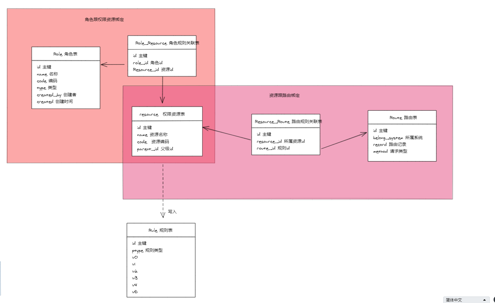

# casbin
基于 php-casbin 的 casbin 封装


# 架构



# 引用

```
composer require teamones/casbin:^3.0
```
## 3.x / PHP 8.5

3.0.0 延续已验证的 Casbin 3.25.1 策略引擎及 PHP 8.5 E_ALL 兼容修复，保留 Casbin 和 Casbin\WebmanPermission 命名空间、权限判定与适配器 API。IPTools 保留 1.2.0 的协议行为。升级引用使用 ^3.0，具体分发版本由 composer.lock 记录。

兼容回归覆盖角色授权、策略撤销、IPv4/IPv6 网络匹配及范围计数；third_party 中保留上游版本、许可证与修补说明。
